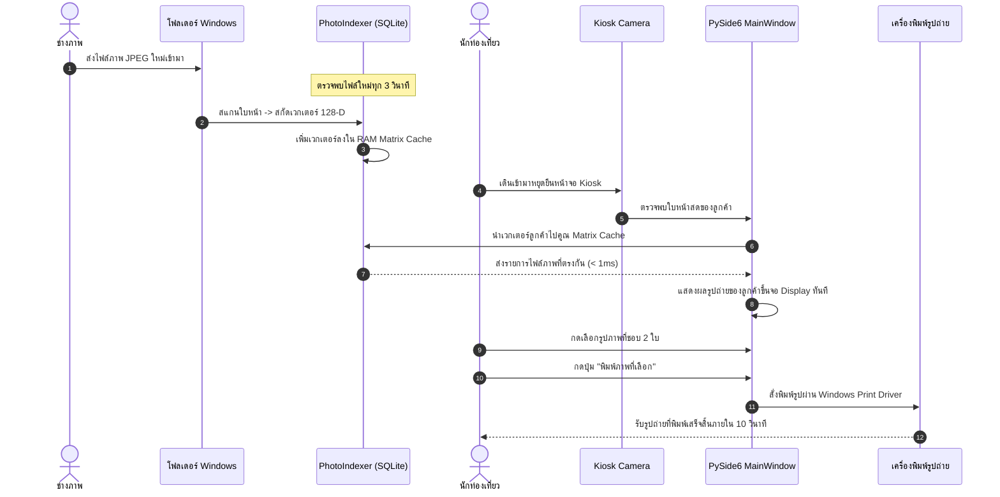
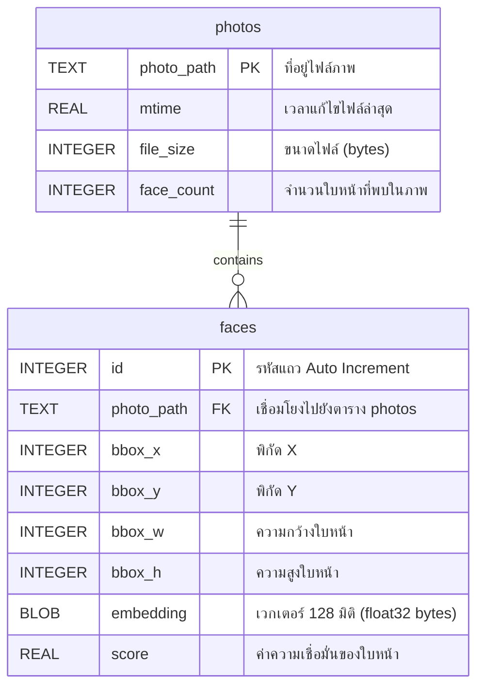

# 📘 บทเรียนเชิงวิศวกรรมฉบับสมบูรณ์: การสร้างระบบค้นหาและพิมพ์ภาพถ่ายท่องเที่ยวอัตโนมัติด้วย Edge AI
## (Building an Edge AI Smart Photo Kiosk with Python, OpenCV DNN, SQLite & PySide6)

---

## 📑 สารบัญ (Table of Contents)
1. [บทนำและโจทย์ทางวิศวกรรม (The Engineering Challenge)](#1-บทนำและโจทย์ทางวิศวกรรม)
   - 1.1 บริบททางธุรกิจของระบบภาพถ่ายแหล่งท่องเที่ยว
   - 1.2 ปัญหาคอขวดและข้อจำกัดของระบบเดิม
   - 1.3 ข้อกำหนดทางวิศวกรรม (Engineering Specifications)
   - 1.4 การเปรียบเทียบ: Edge Computing vs Cloud API
2. [สถาปัตยกรรมระบบโดยรวม (System Architecture)](#2-สถาปัตยกรรมระบบโดยรวม)
   - 2.1 แผนภาพสถาปัตยกรรม 2 Pipeline คู่ขนาน (Architecture Diagram)
   - 2.2 ลำดับขั้นตอนการทำงานทั้งระบบ (End-to-End Sequence Diagram)
3. [ทฤษฎี Computer Vision & Face Recognition เชิงลึก](#3-ทฤษฎี-computer-vision--face-recognition-เชิงลึก)
   - 3.1 ทำไมไม่ใช้ Pixel Matching หรือ Template Matching?
   - 3.2 การตรวจจับใบหน้าด้วยโมเดล YuNet (Anchor-based CNN)
   - 3.3 การปรับระนาบใบหน้าด้วย 5 จุดอ้างอิง (Face Alignment & Affine Transform)
   - 3.4 ทฤษฎี Deep Metric Learning และการสกัดเวกเตอร์ด้วย SFace
   - 3.5 เวกเตอร์ 128 มิติ (128-D Face Embedding on Hypersphere)
   - 3.6 คณิตศาสตร์การค้นหาเวกเตอร์ความเร็วสูง (Vectorized Cosine Similarity)
4. [การออกแบบสถาปัตยกรรมซอฟต์แวร์และการทำงานแบบ Concurrency](#4-การออกแบบสถาปัตยกรรมซอฟต์แวร์และการทำงานแบบ-concurrency)
   - 4.1 วิเคราะห์ปัญหา C++ Race Condition ใน OpenCV DNN
   - 4.2 กลยุทธ์การแก้ปัญหาด้วย Threading Lock และ Worker Isolation
   - 4.3 โครงสร้างฐานข้อมูลและการทำแคช (SQLite + In-Memory Matrix)
   - 4.4 การดัชนีรูปภาพแบบเพิ่มทีละส่วน (Incremental Ingestion)
   - 4.5 สถาปัตยกรรม Event-Driven ด้วย PySide6 Signal & Slot
5. [เจาะลึกโค้ดและการทำงานทีละบรรทัด (Line-by-Line Code Walkthrough)](#5-เจาะลึกโค้ดและการทำงานทีละบรรทัด)
   - 5.1 โมดูล FaceEngine (`core/face_engine.py`)
   - 5.2 โมดูล PhotoIndexer (`core/indexer.py`)
   - 5.3 โมดูล CameraWorker (`core/camera_worker.py`)
   - 5.4 โมดูล MainWindow & Gallery UI (`ui/main_window.py`)
6. [วิศวกรรมการผลิตและคู่มือการนำไปใช้งานจริง (Production Engineering Runbook)](#6-วิศวกรรมการผลิตและคู่มือการนำไปใช้งานจริง)
   - 6.1 การจัดการรูปถ่ายความละเอียดสูงจากกล้องโปร (DSLR 24MP–48MP)
   - 6.2 การรองรับภาพหมู่และภาพครอบครัว (One-to-Many Facial Mapping)
   - 6.3 คู่มือการเลือกอุปกรณ์ฮาร์ดแวร์ (Hardware Procurement Sizing Guide)
   - 6.4 การควบคุมสภาพแสงและการปรับจูน Sensitivity Threshold
   - 6.5 การเชื่อมต่อเครื่องพิมพ์ภาพด่วน (Dye-Sublimation Photo Printers)
   - 6.6 ความปลอดภัยของข้อมูลและการปฏิบัติตามกฎหมาย PDPA
7. [แบบฝึกหัดทบทวนและแนวทางต่อยอด (Exercises & Roadmap)](#7-แบบฝึกหัดทบทวนและแนวทางต่อยอด)

---

## 1. บทนำและโจทย์ทางวิศวกรรม

### 1.1 บริบททางธุรกิจของระบบภาพถ่ายแหล่งท่องเที่ยว
ในธุรกิจสวนสนุก (Theme Parks), สวนน้ำ, พิพิธภัณฑ์, งานอีเวนต์, หรือจุดชมวิว ช่างภาพมืออาชีพจะกระจายตัวอยู่ตามจุดไฮไลต์ต่างๆ ตลอดทั้งวัน เพื่อถ่ายภาพความประทับใจของนักท่องเที่ยว รูปถ่ายที่ได้จะถูกส่งผ่านระบบ Wi-Fi หรือการนำ SD Card มาถ่ายโอนเข้าสู่เครื่องคอมพิวเตอร์ที่เคาน์เตอร์พิมพ์ภาพหน้าร้าน (Photo Kiosk Counter)

### 1.2 ปัญหาคอขวดและข้อจำกัดของระบบเดิม
* **ค้นหาช้า:** ในหนึ่งวันมีรูปถ่ายสะสม $5,000 - 20,000$ รูป การให้พนักงานหรือลูกค้ามาเลื่อนดูทีละหน้าจอทำให้เกิดคิวยาว ลูกค้าหมดความอดทนและเดินออกจากร้าน
* **จำหน้าไม่ได้:** พนักงานไม่สามารถจดจำหน้านักท่องเที่ยวทุกคนที่เดินเข้ามาในร้านได้
* **ยอดขายตก:** อัตราการเปลี่ยนผู้เข้าชมเป็นผู้ซื้อ (Conversion Rate) ตกต่ำเนื่องจากความล่าช้าในการค้นหาภาพ

### 1.3 ข้อกำหนดทางวิศวกรรม (Engineering Specifications)

| ตัวชี้วัด (Metric) | เป้าหมายที่ต้องการ (Target SLA) | ผลการทำจริงในโปรเจกต์นี้ |
| :--- | :--- | :--- |
| **Search Latency (ความเร็วค้นหา)** | $< 1.0$ วินาที | **$< 0.001$ วินาที ($< 1$ ms)** ด้วย Vector Dot Product |
| **Detection Speed (ตรวจจับใบหน้า)** | $< 50$ ms ต่อเฟรม | **$\sim 18 - 25$ ms** ด้วย YuNet บน CPU |
| **Platform Compatibility** | ใช้งานบน Windows 10/11 | ใช้งานได้ทันที 100% (Native Python + PySide6) |
| **Internet Dependency** | ทำงาน Offline ได้ 100% | Edge AI รันในเครื่องทั้งหมด ไม่ต่อเน็ตก็ทำงานได้ |
| **Photo Quality Retention** | คงความละเอียดภาพ 100% | ระบบสแกนพิกัดแล้วย้อนกลับไปอ่านไฟล์ต้นฉบับ |

### 1.4 การเปรียบเทียบ: Edge Computing vs Cloud API

```
+------------------------------------+------------------------------------+
|         Cloud-based AI             |        Edge AI (โปรเจกต์นี้)        |
|  (AWS Rekognition / Azure Face)    |       (OpenCV YuNet + SFace)       |
+------------------------------------+------------------------------------+
| - มีค่าใช้จ่าย $1 - $3 ต่อ 1,000 รูป| - ฟรี 100% ไม่มีค่าบริการรายเดือน  |
| - ถ่าย 10,000 รูป/วัน = $300+/เดือน | - ค่าซอฟต์แวร์เป็น 0 บาท            |
| - ต้องต่ออินเทอร์เน็ตความเร็วสูง     | - ทำงาน Offline หน้างานได้ 100%    |
| - มีปัญหา Latency สัญญาณเน็ตสะดุด  | - Latency ระดับ Millisecond ในเครื่อง|
| - มีความเสี่ยงเรื่อง PDPA ในการส่ง  | - รูปและเวกเตอร์ไม่เคยออกจากเครื่อง  |
|   รูปคนขึ้นเซิร์ฟเวอร์ภายนอก        |   มีความปลอดภัยและเป็นส่วนตัวสูง     |
+------------------------------------+------------------------------------+
```

---

## 2. สถาปัตยกรรมระบบโดยรวม (System Architecture)

### 2.1 แผนภาพสถาปัตยกรรม 2 Pipeline คู่ขนาน

ระบบถูกออกแบบให้ทำงานแบบ Asynchronous แยกเป็น 2 Pipeline ชัดเจน:

```mermaid
flowchart TD
    subgraph P1["Pipeline 1: Background Photo Ingestion"]
        A["กล้องช่างภาพ (DSLR)"] -->|"Wi-Fi / LAN / SD Card"| B["โฟลเดอร์ภาพถ่าย Windows\n(e.g., demo_photos/)"]
        B --> C["Folder Watcher Thread\n(ตรวจจับไฟล์ภาพใหม่ทุก 3 วิ)"]
        C --> D["FaceEngine: YuNet\n(ตรวจจับทุกใบหน้าในรูป)"]
        D --> E["FaceEngine: SFace\n(สกัดเวกเตอร์ 128 มิติ)"]
        E --> F[("SQLite Database\n(ตาราง photos & faces)")]
        F --> G["In-Memory Matrix Cache\n(เมทริกซ์ขนาด N x 128)"]
    end

    subgraph P2["Pipeline 2: Live Kiosk Sensor & Instant Match"]
        H["กล้องหน้า Kiosk (Webcam/CCTV)"] --> I["CameraWorker Thread\n(OpenCV VideoCapture 30 FPS)"]
        I --> J["YuNet: ตรวจจับใบหน้าลูกค้าสด"]
        J --> K["SFace: สกัดเวกเตอร์ลูกค้า 128-D"]
        K --> L["Vector Dot Product\n(Q @ Matrix.T)"]
        L --> M{"คะแนน Cosine Sim\n>= Threshold (0.36) ?"}
        M -->|ใช่| N["PySide6 MainWindow\n(แสดงผลในกริดแกลเลอรี)"]
        M -->|ไม่ใช่| O["รอการตรวจจับรอบถัดไป"]
        N --> P["ลูกค้า/พนักงานเลือกภาพ"]
        P --> Q["ส่งพิมพ์ไปยังเครื่องพิมพ์\n(Photo Printer 4x6)"]
    end
```



### 2.2 ลำดับขั้นตอนการทำงานทั้งระบบ (End-to-End Sequence Diagram)



---

## 3. ทฤษฎี Computer Vision & Face Recognition เชิงลึก

### 3.1 ทำไมไม่ใช้ Pixel Matching หรือ Template Matching?
ภาพถ่ายใบหน้าคนมีความซับซ้อนสูงมาก ไม่สามารถเปรียบเทียบความคล้ายคลึงด้วยระยะห่างของพิกเซล (Pixel L2 / MSE) หรือ Color Histogram ได้ เนื่องจาก:
1. **Pose Variation:** ลูกค้าเอียงคอ หันซ้าย หันขวา ก้ม หรือเงย
2. **Illumination:** ถ่ายกลางแจ้งแดดจัด เทียบกับยืนในร่มแสงนีออน ค่าพิกเซล RGB จะต่างกันอย่างมหาศาล
3. **Expression & Age:** การยิ้ม อ้าปาก หรือหลับตา ทำให้รูปทรงของกล้ามเนื้อบนใบหน้าเปลี่ยนรูป

### 3.2 การตรวจจับใบหน้าด้วยโมเดล YuNet (Anchor-based CNN)
**YuNet** เป็นโครงข่ายประสาทเทียมแบบ Single-Stage Convolutional Network ออกแบบมาเพื่อตรวจจับใบหน้าบน Edge Devices ด้วยความเร็วสูงมาก:

* **Input Resolution:** รับภาพอินพุตขนาด $(W_{in}, H_{in})$
* **Feature Pyramids:** สกัด Feature Map หลากหลายระดับเพื่อตรวจจับทั้งใบหน้าขนาดใหญ่ (ยืนใกล้กล้อง) และใบหน้าขนาดเล็ก (ยืนอยู่ไกล)
* **Output Tensor 15 ค่า:** สำหรับแต่ละใบหน้าที่ตรวจพบ จะได้ข้อมูล:
  $$[x, y, w, h, x_{re}, y_{re}, x_{le}, y_{le}, x_{nt}, y_{nt}, x_{rcm}, y_{rcm}, x_{lcm}, y_{lcm}, \text{score}]$$
  * $(x, y, w, h)$: พิกัดกรอบสี่เหลี่ยมรอบใบหน้า (Bounding Box)
  * $(x_{re}, y_{re})$: พิกัดกึ่งกลางรูม่านตาขวา (Right Eye)
  * $(x_{le}, y_{le})$: พิกัดกึ่งกลางรูม่านตาซ้าย (Left Eye)
  * $(x_{nt}, y_{nt})$: พิกัดปลายจมูก (Nose Tip)
  * $(x_{rcm}, y_{rcm})$: พิกัดมุมปากขวา (Right Mouth Corner)
  * $(x_{lcm}, y_{lcm})$: พิกัดมุมปากซ้าย (Left Mouth Corner)
  * $\text{score} \in [0.0, 1.0]$: ค่าความมั่นใจของโมเดล

### 3.3 การปรับระนาบใบหน้า (Face Alignment & Affine Transform)
หากส่งภาพใบหน้าที่เอียงคอเข้าไปในโมเดลจดจำตัวตน ผลการสกัดเวกเตอร์จะเพี้ยนสูงมาก การทำ **Alignment** จึงเป็นหัวใจสำคัญ:

1. กำหนดพิกัดอ้างอิงมาตรฐาน (Canonical Coordinates) ของใบหน้าที่ตั้งตรงบนขนาดภาพ $112 \times 112$:
   * ตาขวามาตรฐาน: $(38.29, 51.70)$
   * ตาซ้ายมาตรฐาน: $(73.53, 51.70)$
2. คำนวณเมทริกซ์การแปลงสภาพเชิงระนาบ **2D Affine Transformation Matrix ($M \in \mathbb{R}^{2 \times 3}$)**:
   $$\begin{bmatrix} x' \\ y' \end{bmatrix} = \begin{bmatrix} a & b \\ c & d \end{bmatrix} \begin{bmatrix} x \\ y \end{bmatrix} + \begin{bmatrix} t_x \\ t_y \end{bmatrix}$$
3. หมุน ยืด และตัดภาพ (Warp & Crop) ให้ดวงตาทั้งสองข้างอยู่ในแนวนอนเสมอ ได้ภาพใบหน้าขนาด $112 \times 112$ พิกเซล ที่พร้อมส่งเข้าสู่โมเดล SFace

### 3.4 ทฤษฎี Deep Metric Learning และการสกัดเวกเตอร์ด้วย SFace
**SFace** เป็นโครงข่ายประสาทเทียมแบบ Deep CNN ที่ฝึกฝนด้วยแนวคิด **SphereFace (Angular Margin Loss)** แทนที่จะจำแนกคลาสแบบธรรมดา โมเดลจะเรียนรู้เพื่อแปลงภาพใบหน้าให้เป็นจุดพิกัดบนทรงกลมหลายมิติ (Hypersphere):

$$\mathcal{L} = -\frac{1}{N} \sum_{i=1}^{N} \log \frac{e^{\|\vec{x}_i\| \cos(m \theta_{y_i})}}{e^{\|\vec{x}_i\| \cos(m \theta_{y_i})} + \sum_{j \neq y_i} e^{\|\vec{x}_i\| \cos(\theta_j)}}$$

* $m \ge 1$: ตัวคูณ Angular Margin ที่บังคับให้เวกเตอร์ของบุคคลเดียวกันถูกบีบเข้าหากันให้แน่นขึ้นในเชิงมุม
* การฝึกฝนแบบนี้ทำให้ระยะเชิงมุมระหว่างภาพคนละคนกว้างขึ้นอย่างชัดเจน

### 3.5 เวกเตอร์ 128 มิติ (128-D Face Embedding on Hypersphere)
ผลลัพธ์จากการรันภาพ $112 \times 112$ ผ่าน SFace คือเวกเตอร์จำนวนจริง 128 ตัว:
$$\vec{V} = [v_0, v_1, v_2, \dots, v_{127}] \in \mathbb{R}^{128}$$

เพื่อความสะดวกในการเปรียบเทียบ เราจะทำ **L2 Normalization**:
$$\hat{V} = \frac{\vec{V}}{\|\vec{V}\|_2} = \frac{\vec{V}}{\sqrt{\sum_{k=0}^{127} v_k^2}}$$
ทำให้ขนาดความยาวของเวกเตอร์ $\|\hat{V}\| = 1.0$ เสมอ

### 3.6 คณิตศาสตร์การค้นหาเวกเตอร์ความเร็วสูง (Vectorized Cosine Similarity)
เมื่อเวกเตอร์มีความยาวเท่ากับ 1 ค่า **Cosine Similarity** ระหว่างเวกเตอร์สองตัว $\vec{A}$ และ $\vec{B}$ จะมีค่าเท่ากับการทำ **Dot Product** ธรรมดา:

$$\text{CosineSimilarity}(\vec{A}, \vec{B}) = \vec{A} \cdot \vec{B} = \sum_{k=0}^{127} A_k B_k$$

หากในคลังรูปภาพมี $N$ ใบหน้า เรานำเวกเตอร์ทั้งหมดมารวมเป็นเมทริกซ์ $\mathbf{M} \in \mathbb{R}^{N \times 128}$:
$$\mathbf{M} = \begin{bmatrix} \text{—} & \vec{V}_1 & \text{—} \\ \text{—} & \vec{V}_2 & \text{—} \\ & \vdots & \\ \text{—} & \vec{V}_N & \text{—} \end{bmatrix}$$

เมื่อมีลูกค้ามายืนหน้ากล้อง และได้เวกเตอร์ $\vec{Q} \in \mathbb{R}^{128}$ การหาความคล้ายคลึงกับทุกรูปในระบบทำได้ด้วย:

$$\vec{S} = \mathbf{M} \times \vec{Q}^T \quad \in \mathbb{R}^N$$

* การคูณนี้ถูกประมวลผลด้วยคำสั่ง SIMD (AVX2/FMA) บน CPU ผ่าน NumPy หรือ OpenBLAS
* **ประสิทธิภาพ:** เมทริกซ์ขนาด $10,000 \times 128$ ใช้เวลาคำนวณเพียง **$0.0003$ วินาที ($0.3$ ms)!**
* **เกณฑ์การตัดสิน (Threshold Criteria):**
  * สำหรับโมเดล SFace ค่า Cosine Similarity:
    * $\ge 0.363$: จัดว่าเป็น "บุคคลเดียวกัน" (ค่าเริ่มต้นมาตรฐานของ OpenCV Zoo)
    * ในแอปพลิเคชันนี้เราทำ Slider ให้ปรับได้ระหว่าง $0.25 - 0.55$ เพื่อความยืดหยุ่นหน้างาน

---

## 4. การออกแบบสถาปัตยกรรมซอฟต์แวร์และการทำงานแบบ Concurrency

### 4.1 วิเคราะห์ปัญหา C++ Race Condition ใน OpenCV DNN
ระหว่างการพัฒนาแอปพลิเคชัน หากปล่อยให้มี 2 เธรดทำงานพร้อมกัน:
1. เธรดที่ 1 (`CameraWorker`): ดึงเฟรมกล้องมา Detect หน้าคนทุกๆ 33 ms
2. เธรดที่ 2 (`PhotoIndexer` / UI Thread): สแกนรูปภาพในโฟลเดอร์มา Detect หน้าคน

จะเกิดข้อผิดพลาดรุนแรงระดับ C++ และทำให้แอป Crash ทันที:
```text
cv2.error: Unknown C++ exception from OpenCV code
```
**สาเหตุเชิงลึก:** คลาส `cv2.FaceDetectorYN` มีการจัดการหน่วยความจำภายในเป็น C++ Pointer เมื่อเรียก `detector.setInputSize(w, h)` ตัว C++ Runtime จะทำการ Allocate ขนาด Blob ใน Net Engine ใหม่ หากมีอีกเธรดหนึ่งเรียก `detector.detect(img)` จังหวะเดียวกัน Pointer จะชี้ไปที่หน่วยความจำที่ไม่ถูกต้องทันที

### 4.2 กลยุทธ์การแก้ปัญหาด้วย Threading Lock
เราแก้ไขปัญหานี้อย่างสมบูรณ์แบบด้วยการใช้ **Mutual Exclusion Lock (`threading.Lock`)**:

```python
class FaceEngine:
    def __init__(self, ...):
        self._lock = threading.Lock()

    def extract_faces_from_image(self, img_bgr, max_detect_dim=1280):
        # ป้องกันไม่ให้สองเธรดเรียกใช้ C++ DNN พร้อมกัน
        with self._lock:
            self.detector.setInputSize((detect_w, detect_h))
            status, faces = self.detector.detect(detect_img)
            # Alignment และ Feature Extraction
            return results
```
เมื่อเธรดหนึ่งกำลังประมวลผล อีกเธรดหนึ่งจะรอจนกว่าจะเสร็จสิ้น ใช้เวลาเฉลี่ยเพียงไม่กี่สิบมิลลิวินาที จึงไม่กระทบต่อความลื่นไหลของภาพวิดีโอสด

### 4.3 โครงสร้างฐานข้อมูลและการทำแคช (SQLite Database Schema)
เราออกแบบฐานข้อมูล SQLite (`photo_index.db`) ด้วยโครงสร้างความสัมพันธ์แบบ 1-to-Many:



* เวกเตอร์ 128 มิติ (ชนิด `np.float32`) จะถูกแปลงเป็นไบต์ดิบ (`tobytes()`) ขนาดคงที่ $128 \times 4 = 512$ ไบต์ และเก็บลงคอลัมน์ `BLOB`
* เมื่อแอปเปิดขึ้นมา ฟังก์ชัน `load_cache_from_db()` จะอ่าน BLOB ทั้งหมดขึ้นมาแปลงกลับเป็น NumPy Matrix ขนาด $(N, 128)$ ครั้งเดียวในหน่วยความจำ RAM

### 4.4 การดัชนีรูปภาพแบบเพิ่มทีละส่วน (Incremental Ingestion)
เพื่อความเร็วในการทำงาน ระบบจะไม่สแกนรูปเดิมซ้ำ:
1. ตรวจสอบไฟล์ในโฟลเดอร์: ดึงค่า `st_mtime` และ `st_size` ของแต่ละไฟล์ภาพ
2. ตรวจสอบกับฐานข้อมูล: หาก `photo_path` มีอยู่แล้ว และเวลาแก้ไขตรงกัน จะ **ข้าม (Skip)** ทันที
3. ประมวลผลเฉพาะไฟล์ใหม่หรือไฟล์ที่มีการแก้ไขเท่านั้น

### 4.5 สถาปัตยกรรม Event-Driven ด้วย PySide6 Signal & Slot
ใน GUI Programming ห้ามมิให้ Background Thread เข้าไปสั่งแก้ไขวิดเจ็ตบนหน้าจอโดยตรง เพราะจะทำให้ระบบปฏิบัติการ Windows บังคับปิดโปรแกรม (GUI Thread Violation):

```text
[CameraWorker QThread] ──(Signal: frame_ready)────► [MainWindow Slot: _on_camera_frame]
[CameraWorker QThread] ──(Signal: face_detected)──► [MainWindow Slot: _on_face_detected]
[CameraWorker QThread] ──(Signal: face_cleared)───► [MainWindow Slot: _on_face_cleared]
[PhotoCardWidget]      ──(Signal: print_clicked)──► [MainWindow Slot: _on_print_single]
```

---

## 5. เจาะลึกโค้ดและการทำงานทีละบรรทัด (Line-by-Line Code Walkthrough)

### 5.1 โมดูล FaceEngine (`core/face_engine.py`)

```python
# รองรับการเปิดไฟล์ภาพที่มีชื่อภาษาไทยหรืออักขระพิเศษบน Windows
def extract_faces_from_file(self, file_path: str):
    with open(file_path, "rb") as f:
        bytes_data = bytearray(f.read())
    nparr = np.asarray(bytes_data, dtype=np.uint8)
    img = cv2.imdecode(nparr, cv2.IMREAD_COLOR)  # เลี่ยงข้อจำกัดของ cv2.imread บน Windows
    return self.extract_faces_from_image(img)
```
* **คำอธิบาย:** บนระบบปฏิบัติการ Windows ฟังก์ชัน `cv2.imread()` ไม่รองรับ Path ที่มีตัวอักษรภาษาไทยหรือ Unicode (จะคืนค่า `None`) การอ่านไฟล์ผ่าน `open(file_path, "rb")` แล้วใช้ `cv2.imdecode()` จะแก้ปัญหานี้ได้อย่างสมบูรณ์

```python
# การย่อขนาดภาพเพื่อตรวจจับอย่างรวดเร็ว (Downscale for Detection Speed)
scale = 1.0
if max(orig_h, orig_w) > max_detect_dim:
    scale = max_detect_dim / float(max(orig_h, orig_w))
    detect_img = cv2.resize(img_bgr, (int(orig_w * scale), int(orig_h * scale)))
```
* **คำอธิบาย:** สำหรับภาพจากกล้องโปร DSLR ขนาด 24 ล้านพิกเซล (6000 $\times$ 4000) หากส่งเข้าโมเดลตรงๆ จะกินเวลาเกือบ 0.5 วินาที การย่อภาพลงมาเหลือด้านยาวไม่เกิน 1280px จะทำให้ตรวจจับเสร็จใน 20-30 ms จากนั้นจึงสเกลพิกัดใบหน้ากลับด้วยตัวคูณ `1.0 / scale` เพื่อคร็อปจากภาพความละเอียดสูงต้นฉบับ

### 5.2 โมดูล PhotoIndexer (`core/indexer.py`)

```python
def search_by_face(self, query_feat: np.ndarray, threshold: float = 0.38, top_k: int = 50):
    if self.matrix.shape[0] == 0:
        return []

    # คูณเมทริกซ์ 1 บรรทัด หาความคล้ายกับทุกรูปในระบบพร้อมกัน
    sims = np.dot(self.matrix, query_feat)

    # กรองเฉพาะแถวที่ความเหมือนมากกว่าเกณฑ์
    matched_indices = np.where(sims >= threshold)[0]
    
    photo_matches = {}
    for idx in matched_indices:
        sim = float(sims[idx])
        rec = self.records[idx]
        p_path = rec["photo_path"]
        
        # คำนวณเป็นเปอร์เซ็นต์เข้าใจง่ายสำหรับแสดงบนการ์ด UI
        match_pct = int(min(100, max(0, (sim - 0.20) / 0.50 * 100)))

        # หากเป็นรูปกลุ่มที่มีหลายคน ให้เก็บคะแนนสูงสุดของรูปนั้น
        if p_path not in photo_matches or sim > photo_matches[p_path]["similarity"]:
            photo_matches[p_path] = {
                "photo_path": p_path,
                "similarity": sim,
                "match_percentage": match_pct,
                "bbox": rec["bbox"]
            }

    results = list(photo_matches.values())
    results.sort(key=lambda x: x["similarity"], reverse=True)
    return results[:top_k]
```

### 5.3 โมดูล CameraWorker (`core/camera_worker.py`)

```python
# การทำ Throttling ป้องกันการค้นหาถี่เกินไป
now = time.time()
if faces:
    self.last_face_time = now
    # เรียงลำดับเอาใบหน้าที่ใหญ่ที่สุด (คนที่ยืนใกล้กล้องที่สุด)
    faces.sort(key=lambda item: item[0][2] * item[0][3], reverse=True)
    primary_bbox, primary_feat, primary_score = faces[0]

    # ส่งสัญญาณค้นหาทุกๆ 400ms เมื่อลูกค้ายืนนิ่งหน้ากล้อง
    if now - self.last_query_time >= self.query_interval:
        self.last_query_time = now
        self.face_detected.emit(face_crop, primary_feat)
```
* **คำอธิบาย:** กล้องวิดีโอวิ่งที่ 30 FPS หากส่งคำสั่งค้นหาฐานข้อมูลทุก 33 ms หน้าจอแสดงผลจะกระพริบและประมวลผลซ้ำซ้อน การหน่วงเวลาด้วย `query_interval = 0.4` (400 ms) จะทำให้ระบบมีเสถียรภาพและนุ่มนวล

---

## 6. วิศวกรรมการผลิตและคู่มือการนำไปใช้งานจริง (Production Engineering Runbook)

### 6.1 การจัดการรูปถ่ายความละเอียดสูงจากกล้องโปร (DSLR 24MP–48MP)
* **กลยุทธ์ Resolution Pyramiding:**
  1. ไฟล์ภาพดิบถูกบันทึกลงในไดรฟ์ SSD NVMe ความเร็วสูง
  2. Background Worker สร้าง Thumbnail ขนาดเล็ก ($320 \times 240$) เก็บไว้ในโฟลเดอร์แคชสำหรับแสดงผลบน UI ได้ทันทีโดยไม่ต้องโหลดไฟล์ภาพขนาดเต็ม 30MB ทุกครั้ง
  3. เมื่อลูกค้ากดสั่งพิมพ์ จึงค่อยเรียกไฟล์ต้นฉบับขนาดเต็มส่งไปยังเครื่องพิมพ์ เพื่อให้ได้ภาพพิมพ์คมชัดระดับ 300 DPI

### 6.2 การรองรับภาพหมู่และภาพครอบครัว (One-to-Many Facial Mapping)
ในรูปถ่ายท่องเที่ยว มากกว่า 70% จะเป็นภาพคู่หรือภาพกลุ่ม:
* หากในรูป `IMG_0850.jpg` มีบุคคล A, B และ C ระบบจะสร้างแถวข้อมูลในตาราง `faces` จำนวน 3 แถว ที่มี `photo_path` เดียวกัน
* เมื่อบุคคล A เดินมาหน้ากล้อง $\to$ รูป `IMG_0850.jpg` จะปรากฏ
* เมื่อบุคคล B หรือ C เดินมาหน้ากล้อง $\to$ รูป `IMG_0850.jpg` ก็จะปรากฏให้คนเหล่านั้นเช่นเดียวกัน

### 6.3 คู่มือการเลือกอุปกรณ์ฮาร์ดแวร์ (Hardware Procurement Sizing Guide)

```
┌─────────────────────────────────────────────────────────────────────────────────┐
│              รายการฮาร์ดแวร์แนะนำสำหรับ Kiosk หน้าร้าน 1 จุด                     │
├───────────────────────┬─────────────────────────────────────────────────────────┤
│ อุปกรณ์               │ สเปกที่แนะนำสำหรับการใช้งานจริง                          │
├───────────────────────┼─────────────────────────────────────────────────────────┤
│ 1. เครื่องคอมพิวเตอร์ │ - CPU: Intel Core i5 (Gen 12+) หรือ AMD Ryzen 5 (5600G+)│
│    (Host PC)          │ - RAM: 16 GB DDR4/DDR5                                  │
│                       │ - Storage: M.2 NVMe SSD 1 TB (Read/Write > 3,000 MB/s)  │
│                       │ - OS: Windows 10/11 Pro (64-bit)                        │
├───────────────────────┼─────────────────────────────────────────────────────────┤
│ 2. กล้องตรวจจับใบหน้า │ - Logitech Brio 4K หรือ Logitech C920 Pro HD            │
│                       │ - ติดตั้งที่ระดับสายตา (ความสูง ~140 - 160 cm จากพื้น)   │
├───────────────────────┼─────────────────────────────────────────────────────────┤
│ 3. จอภาพแสดงผล        │ - จอสัมผัส Touchscreen ขนาด 27 - 32 นิ้ว (Full HD)      │
│                       │   (เช่น ViewSonic, Dell หรือ Elo Touch)                 │
├───────────────────────┼─────────────────────────────────────────────────────────┤
│ 4. เครื่องพิมพ์ภาพถ่าย│ - Dye-Sublimation Photo Printer                         │
│                       │   (เช่น DNP DS620, Citizen CY-02, หรือ Epson SureLab)   │
│                       │ - ความเร็วในการพิมพ์: 8.9 วินาทีต่อภาพ (ขนาด 4x6 นิ้ว)   │
├───────────────────────┼─────────────────────────────────────────────────────────┤
│ 5. อุปกรณ์เสริมแสง    │ - ไฟวงแหวน LED (Ring Light) หรือ Soft Light ขนาดเล็ก    │
│                       │   ติดเหนือหน้าจอ เพื่อให้ใบหน้าลูกค้าสว่างสม่ำเสมอ       │
└───────────────────────┴─────────────────────────────────────────────────────────┘
```

### 6.4 การควบคุมสภาพแสงและการปรับจูน Sensitivity Threshold
* **ตารางคำแนะนำการตั้งค่า Threshold:**

| ช่วงค่า Threshold | พฤติกรรมของระบบ | บริบทที่เหมาะสม |
| :---: | :--- | :--- |
| **0.28 – 0.33** | ค้นหาเจอง่ายมาก แต่อาจมีรูปคนอื่นที่หน้าคล้ายกันหลุดมาบ้าง | สถานที่ที่แสงสลัว หรือลูกค้าใส่หมวก/แว่นตาหนา |
| **0.36 – 0.40** | **สมดุลสมบูรณ์แบบ (Recommended สำหรับการใช้งานจริง)** | สถานที่ที่มีสภาพแสงควบคุมอย่างเหมาะสม |
| **0.42 – 0.50** | เข้มงวดมาก ป้องกันภาพคนอื่นปน 100% แต่อาจหลุดบางรูปที่มุมหน้าเอียง | งานประชุมทางการ หรืองานที่มีความละเอียดอ่อนสูง |

### 6.5 การเชื่อมต่อเครื่องพิมพ์ภาพด่วน (Dye-Sublimation Photo Printers)
* เครื่องพิมพ์ระบบ **Dye-Sublimation (สีระเหิดด้วยความร้อน)** เป็นมาตรฐานระดับโลกสำหรับร้านพิมพ์ภาพถ่ายด่วน:
  * **กันน้ำและรอยนิ้วมือ 100%:** มีการเคลือบสารป้องกัน UV ชั้นบนสุดทันทีหลังพิมพ์
  * **ไม่มีหัวพิมพ์ตัน:** ไม่ใช้น้ำหมึกเหลว แต่ใช้ม้วนฟิล์มสีริบบอน (YMC + Overcoat)
  * **การสั่งพิมพ์อัตโนมัติ (Hot Folder):** เครื่องพิมพ์ระดับโปรสามารถตั้งค่า Hot Folder ของ Windows เมื่อระบบโยนไฟล์ภาพขนาด 4$\times$6 นิ้วลงโฟลเดอร์ เครื่องพิมพ์จะดูดไปพิมพ์ทันทีใน 8-10 วินาที

### 6.6 ความปลอดภัยของข้อมูลและการปฏิบัติตามกฎหมาย PDPA
1. **การตั้งค่า Auto-Purge:** ตั้งเวลางาน (Scheduled Task) ลบรูปถ่ายและล้างข้อมูลเวกเตอร์ใน SQLite ทุกๆ 24 ชั่วโมงหลังปิดร้าน
2. **ป้ายประกาศแจ้งเตือน (Signage):** ติดป้ายแจ้งเตือนหน้าร้านว่า "ระบบกล้องตรวจจับภาพถ่ายอัตโนมัติเพื่ออำนวยความสะดวกในการเลือกซื้อภาพถ่ายที่ระลึก"
3. **Local-Only:** ข้อมูลภาพถ่ายและเวกเตอร์ใบหน้าไม่เคยถูกอัปโหลดขึ้น Cloud จึงไม่เสี่ยงต่อการรั่วไหลของข้อมูลภายนอก

---

## 7. แบบฝึกหัดทบทวนและแนวทางต่อยอด (Exercises & Roadmap)

### 💡 แบบฝึกหัดท้าทายสำหรับวิศวกร (Engineering Challenges)

1. **Challenge 1 (QR Code Photo Delivery):**  
   พัฒนาฟังก์ชันสร้าง QR Code บนหน้าจอ เพื่อให้ลูกค้าสแกนดาวน์โหลดไฟล์ภาพดิจิทัลต้นฉบับเข้าโทรศัพท์มือถือผ่านเครือข่าย Wi-Fi ท้องถิ่น (Local Web Server ด้วย Python `http.server` หรือ `FastAPI`)
2. **Challenge 2 (Unsupervised Face Clustering - DBSCAN):**  
   ใช้ขั้นตอนวิธี **DBSCAN (Density-Based Spatial Clustering)** จัดกลุ่มรูปภาพของนักท่องเที่ยวแต่ละคนเข้าเป็นอัลบั้มส่วนตัวล่วงหน้าตั้งแต่ตอนที่รูปถูกส่งเข้ามาในระบบ โดยไม่ต้องรอลูกค้าเดินมาหน้ากล้อง
3. **Challenge 3 (Distributed Multi-Kiosk Architecture):**  
   ขยายสถาปัตยกรรมจาก SQLite แบบเครื่องเดียว ให้รองรับระบบ Kiosk 10 จุดรอบสวนสนุก โดยใช้ **Milvus Vector Database** หรือ **PostgreSQL + pgvector** เป็นศูนย์กลางร่วมกันผ่านเครือข่าย LAN
